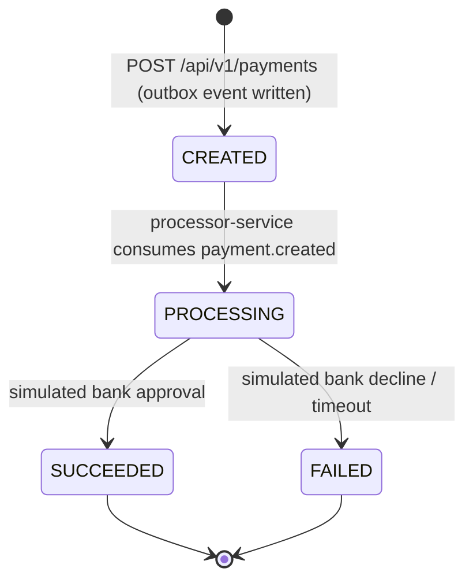

# PayStream 💳⚡

**PayStream** is an enterprise-grade, high-throughput distributed payment gateway built incrementally to demonstrate production-grade distributed systems patterns: **Transactional Outbox**, **Event-Driven Architecture with Kafka (KRaft)**, **Two-Tier Idempotency (Redis + Postgres)**, **Token-Bucket Rate Limiting**, and **JWT-Secured Multi-Tenancy**.

[](https://openjdk.org/)
[](https://spring.io/projects/spring-boot)
[](https://kafka.apache.org/)
[](https://www.postgresql.org/)
[](https://redis.io/)
[](architecture.md)

---

## 🏛️ System Architecture

```
                                  ┌───────────────────────────────┐
                                  │      Client Applications      │
                                  └───────────────┬───────────────┘
                                                  │ HTTPS / REST
                                                  ▼
                                    ┌───────────────────────────┐
                                    │    API Gateway (8080)     │
                                    │  - JWT Verification       │
                                    │  - Redis Rate Limiter     │
                                    │  - Merchant Header Injection
                                    └───────┬───────────┬───────┘
                                            │           │
                    ┌───────────────────────┘           └───────────────────────┐
                    ▼                                                           ▼
       ┌────────────────────────┐                                  ┌────────────────────────┐
       │   auth-service (8082)  │                                  │ payment-service (8081) │
       │  - Merchant Identity   │                                  │  - Payment Lifecycle   │
       │  - API Key Generation  │                                  │  - Idempotency Engine  │
       │  - JWT Minting (HS256) │                                  │  - Transactional Outbox│
       └───────────┬────────────┘                                  └─────┬────────────┬─────┘
                   │                                                     │            │
                   ▼ (Isolated DB)                                       ▼ (Isolated) ▼ (Poller)
          ┌─────────────────┐                                  ┌───────────────┐ ┌────────────────┐
          │ PostgreSQL      │                                  │ PostgreSQL    │ │ Outbox Relay   │
          │ (auth)          │                                  │ (payments)    │ │ (SKIP LOCKED)  │
          └─────────────────┘                                  └───────────────┘ └───────┬────────┘
                                                                                         │
                                     ┌───────────────────────────────────────────────────┘
                                     │ Publishes 'payment.created'
                                     ▼
                        ┌─────────────────────────┐
                        │   Apache Kafka (KRaft)  │
                        │   - payment.created     │
                        │   - payment.processed   │
                        │   - payment.status-chg  │
                        └────────────┬────────────┘
                                     │
           ┌─────────────────────────┴─────────────────────────┐
           │ Consumes 'payment.created'                        │ Consumes 'payment.processed'
           ▼                                                   ▼
┌─────────────────────────────┐                     ┌─────────────────────────────┐
│ processor-service (8083)    │                     │ payment-service             │
│ - Simulates Bank Latency    │                     │ - State Machine Transitions │
│ - Simulates Success/Failure │                     │ - Idempotency Guard (No-op) │
│ - Publishes outcome event   │                     └─────────────────────────────┘
└─────────────────────────────┘
```

---

## 🚀 Key Architectural Pillars

### 1. Asynchronous Decoupling & Transactional Outbox
- **Dual-Write Safety**: Payment records and outbox events are inserted within a single relational PostgreSQL transaction, guaranteeing that events are never lost or orphaned.
- **Concurrent Polling Relay**: `OutboxRelay` queries unpublished events with `SELECT ... FOR UPDATE SKIP LOCKED`. Multiple `payment-service` instances can coordinate batch publishing to Kafka without table locking or distributed transactions (XA).
- **At-Least-Once Delivery**: The outbox relay only marks events published upon synchronous broker acknowledgment (`kafkaTemplate.send().get(5s)`). Rollbacks occur if Kafka is temporarily unreachable.

### 2. Idempotent Consumer & State Machine Guards
- **Zero Dedup Overhead**: Downstream consumers are guarded by the domain entity state machine (`Payment.transitionTo`). Duplicate or out-of-order events trigger `InvalidStatusTransitionException`, which the consumer catches and logs as a benign no-op.
- **State Audit Trail**: Every status transition (`CREATED -> PROCESSING -> SUCCEEDED/FAILED`) is captured in `payment_status_history` for complete auditability.

### 3. Two-Tier Idempotency Engine
- **Fast-Path Redis Cache**: Cached responses for completed requests return immediately with `201 Created` without hitting PostgreSQL.
- **PostgreSQL Source of Truth**: Atomic claims via `INSERT ... ON CONFLICT DO NOTHING` on `idempotency_keys` prevent duplicate execution even if Redis restarts or drops keys.
- **Concurrent Request Handling**: Incoming identical in-flight requests receive `409 Conflict` ("retry shortly") to avoid thread pool exhaustion.

### 4. Zero-Trust API Gateway
- **Identity Propagation**: The gateway validates HS256 JWTs, strips any user-supplied `X-Merchant-Id`, and injects the authenticated merchant ID before proxying upstream.
- **Defense-in-Depth**: Downstream microservices do not expose host ports directly in Docker; all external traffic must flow through the Gateway.
- **Distributed Rate Limiting**: Token-bucket rate limiting backed by Redis protects downstreams from traffic spikes.

---

## 🔄 Payment Lifecycle



---

## 🛠️ Tech Stack

| Component | Technology | Rationale |
|---|---|---|
| **Runtime & Language** | Java 21, Spring Boot 4.1.1 | Modern LTS features, virtual thread readiness, modular auto-configuration |
| **API Gateway** | Spring Cloud Gateway (WebFlux) | Non-blocking reactive gateway with built-in Redis token bucket |
| **Message Broker** | Apache Kafka 3.8.0 (KRaft) | High-throughput distributed log in ZooKeeper-less mode |
| **Databases** | PostgreSQL 16 (per-service) | Relational integrity, `FOR UPDATE SKIP LOCKED`, ACID compliance |
| **Database Migrations** | Flyway | Versioned, deterministic schema migrations |
| **Caching & Limiting** | Redis 7 (Alpine) | In-memory key-value store for rate limiting and idempotency fast-path |
| **Testing** | JUnit 5, Testcontainers, k6 | Real container integration testing and realistic HTTP load generation |

---

## 🏁 Quickstart

### Prerequisites
- Docker Engine & Docker Compose (v2.20+)
- JDK 21+ and Maven (if running tests locally)
- `curl` and `jq`

### 1. Clone & Configure
```bash
git clone git@github.com:harshkha3417/PayStream.git
cd PayStream
cp .env.example .env
```

### 2. Launch Entire Infrastructure
```bash
docker compose up -d --build
```

Verify that all services are healthy and running:
```bash
docker compose ps
```

---

## 🧪 End-to-End Verification

### 1. Register a Merchant
```bash
MERCHANT=$(curl -s -X POST http://localhost:8080/api/v1/merchants \
  -H "Content-Type: application/json" \
  -d '{"name": "Acme Corp"}')

MERCHANT_ID=$(echo "$MERCHANT" | jq -r .merchantId)
API_KEY=$(echo "$MERCHANT" | jq -r .apiKey)
echo "Merchant registered: $MERCHANT_ID"
```

### 2. Obtain JWT Access Token
```bash
TOKEN=$(curl -s -X POST http://localhost:8080/api/v1/auth/token \
  -H "Content-Type: application/json" \
  -d "{\"merchantId\": \"$MERCHANT_ID\", \"apiKey\": \"$API_KEY\"}" | jq -r .accessToken)
```

### 3. Create a Payment (Non-Blocking)
```bash
IDEMPOTENCY_KEY=$(uuidgen)

PAYMENT=$(curl -s -X POST http://localhost:8080/api/v1/payments \
  -H "Content-Type: application/json" \
  -H "Authorization: Bearer $TOKEN" \
  -H "Idempotency-Key: $IDEMPOTENCY_KEY" \
  -d '{"amount": 49900, "currency": "INR", "method": "UPI", "description": "Order #1234"}')

PAYMENT_ID=$(echo "$PAYMENT" | jq -r .id)
echo "Initial Status: $(echo "$PAYMENT" | jq -r .status)" # Output: CREATED
```

### 4. Verify Asynchronous Progression
Wait 1–2 seconds for the Outbox Relay, Kafka, and Processor Service to complete:
```bash
sleep 2
curl -s http://localhost:8080/api/v1/payments/$PAYMENT_ID \
  -H "Authorization: Bearer $TOKEN" | jq .
```
Status transitions automatically to **`SUCCEEDED`** (or `FAILED` per simulation roll).

### 5. Inspect Outbox & Audit Tables
```bash
# Check that all outbox events are drained & published
docker exec paygate-postgres psql -U postgres -d payments -c \
  "SELECT event_type, COUNT(*) as total, COUNT(published_at) as published FROM outbox_events GROUP BY event_type;"

# Check state history audit trail
docker exec paygate-postgres psql -U postgres -d payments -c \
  "SELECT from_status, to_status, created_at FROM payment_status_history WHERE payment_id = '$PAYMENT_ID' ORDER BY created_at ASC;"
```

---

## 📊 Performance & Load Testing

The repository includes [k6](https://k6.io/) load testing scenarios in the `load-tests/` directory:
- `create-payment-gateway.js`: High-concurrency payment creation through Gateway + Kafka pipeline.
- `create-payment-idempotent-cold.js`: Concurrent requests testing database idempotency claims.
- `create-payment-idempotent-replay.js`: Validates high-speed Redis cache replay hits.

Execute a load test:
```bash
k6 run -e RATE=100 -e DURATION=30s load-tests/create-payment-gateway.js
```

---

## 📂 Project Structure

```
PayStream/
├── architecture.md           # Master architecture design & Decisions Log (#1-27)
├── docker-compose.yml        # Orchestration (Kafka, Postgres, Redis, Services)
├── .env.example              # Example environment template
├── docs/                     # In-depth weekly documentation & engineering guides
│   └── WEEK4.md              # Week 4: Kafka, Outbox & Processor deep dive
├── load-tests/               # k6 load testing scripts
├── auth-service/             # Merchant identity & JWT issuance service
├── gateway/                  # Spring Cloud Gateway with Redis rate limiting
├── payment-service/          # Core payment lifecycle, outbox poller & consumer
└── processor-service/        # Asynchronous banking simulation service
```

---

## 📜 Architectural Decisions

All key architectural decisions are documented in the [**Decisions Log (`architecture.md`)**](architecture.md#15-decisions-log), including:
- **Decision #8 & #23**: Transactional Outbox pattern via `SELECT ... FOR UPDATE SKIP LOCKED` poller.
- **Decision #10**: Database-per-service pattern for failure domain isolation.
- **Decision #12**: Intentional envelope duplication over shared common libraries to preserve microservice autonomy.
- **Decision #17 & #19**: Two-tier idempotency with PostgreSQL atomic claims and Redis caching.
- **Decision #25**: Domain state-machine validation as consumer idempotency guards.
- **Decision #27**: Apache Kafka in KRaft mode for cloud-native event streaming.

---

## 📄 License
This project is open-source under the MIT License.
