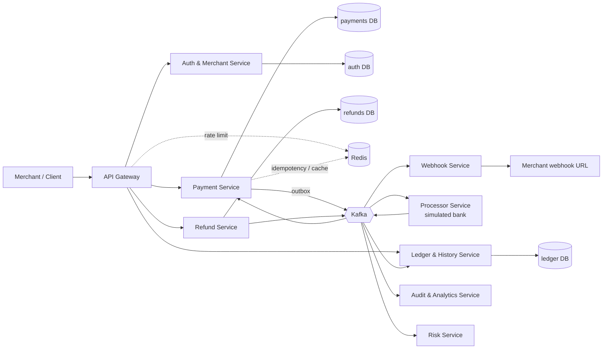
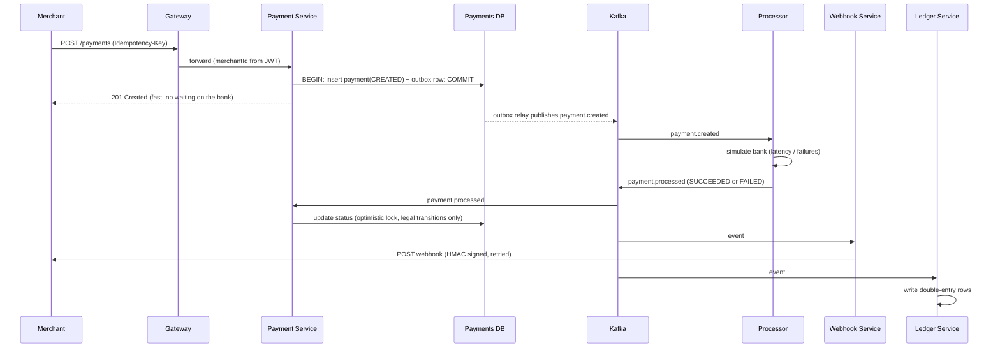
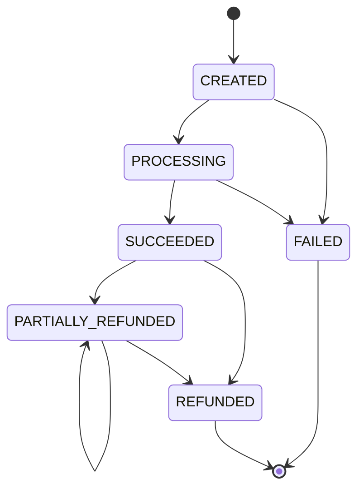

# Payment Gateway — Architecture

A Stripe/Razorpay-style payment processing backend, built as event-driven microservices.
Lifecycle: **Create → Process → Verify → Webhook → Success/Failure → Refund**

> Keep this file updated. Every phase ends with: update the status table (§13), add any new decision to §15.

---

## 1. Goals

- Microservices, not a monolith. Each service owns its data and deploys independently.
- Built in phases. Each phase leaves the system runnable.
- Local first (Docker Compose on a MacBook M2), then AWS.
- Efficient under load. Targets: **1k → 10k → 50k → 100k** requests, with the improvement from every change measured (`docs/benchmarks.md`).
- Correct with money: no double charges, no lost events, full audit trail.

## 2. Tech stack

| Concern | Choice |
|---|---|
| Language / framework | Java 21, Spring Boot |
| Security | Spring Security (JWT for merchants, API keys, HMAC-signed webhooks) |
| Database | PostgreSQL (one database/schema per service) |
| Cache / rate limit / fast idempotency | Redis |
| Messaging | Kafka |
| Packaging | Docker, Docker Compose (local) |
| Load testing | k6 |
| Observability | Spring Actuator, Micrometer, Prometheus, Grafana (Week 7) |
| Cloud | AWS (Week 8) |

## 3. High-level architecture



## 4. Services

| Service | Responsibility | Owns | Publishes | Consumes | Phase |
|---|---|---|---|---|---|
| **API Gateway** | Routing, JWT check, rate limiting | — | — | — | 2 |
| **Auth & Merchant** | Merchants, API keys, roles, tokens | `auth` DB | — | — | 2 |
| **Payment** (core) | Create payment, status, state machine, idempotency | `payments` DB | `payment.created` | `payment.processed` | 1, 3, 4 |
| **Processor** | Simulated card/UPI/bank with configurable latency and failure rate | none | `payment.processed` | `payment.created` | 4 |
| **Refund** | Full/partial refunds, refund rules | `refunds` DB | `refund.requested`, `refund.completed` | `payment.processed` | 5 |
| **Webhook** | Signed webhook delivery, retries, DLQ | `webhooks` DB | — | all `payment.*`, `refund.*` | 5 |
| **Ledger & History** | Double-entry ledger, transaction history read model | `ledger` DB | — | all `payment.*`, `refund.*` | 6 |
| **Audit & Analytics** | Immutable audit log, aggregates | `audit` DB | — | all topics | 6 |
| **Risk** | Fraud detection, risk scoring, anomaly detection | `risk` DB | `risk.assessed` | `payment.created` | 9 |

Rule: a service never reads another service's database. It uses an API call or an event.

## 5. Payment lifecycle



The API never waits for the processor. That is what lets it absorb thousands of requests per second.

## 6. Payment state machine



`FAILED` and `REFUNDED` are terminal. Enforced in code (`PaymentStatus`) and by tests.

## 7. Events and Kafka topics

Envelope for every event:

```json
{ "eventId": "uuid", "type": "payment.created", "occurredAt": "ISO-8601",
  "paymentId": "uuid", "merchantId": "string", "data": { } }
```

| Topic | Key | Producer | Consumers |
|---|---|---|---|
| `payment.created` | paymentId | Payment | Processor, Webhook, Ledger, Audit, Risk |
| `payment.processed` | paymentId | Processor | Payment, Refund |
| `payment.status-changed` | paymentId | Payment | Webhook, Ledger, Audit |
| `refund.requested` | paymentId | Refund | Processor, Audit |
| `refund.completed` | paymentId | Refund | Payment, Webhook, Ledger, Audit |
| `risk.assessed` | paymentId | Risk | Payment, Audit |
| `*.dlq` | — | any consumer | manual review |

Partition key = `paymentId`, so all events for one payment are ordered.

## 8. Data model highlights

**Payment DB**
- `payments(id uuid, merchant_id, amount_minor bigint, currency, payment_method, status, description, version, created_at, updated_at)`
- `payment_status_history(id, payment_id, from_status, to_status, created_at)`
- `idempotency_keys(merchant_id, key, request_hash, response_body, status, created_at)` — unique on `(merchant_id, key)` *(Week 3)*
- `outbox(id, aggregate_id, type, payload jsonb, created_at, published_at)` *(Week 4)*

**Refund DB:** `refunds(id, payment_id, amount_minor, status, reason, created_at)`
**Webhook DB:** `webhook_endpoints`, `webhook_deliveries(id, event_id, attempt, status, next_retry_at)`
**Ledger DB:** `ledger_entries(id, payment_id, account, direction DEBIT|CREDIT, amount_minor, created_at)` — every payment produces balanced debit/credit rows
**Audit DB:** `audit_log(id, actor, action, entity, entity_id, before, after, created_at)` — insert-only
**Every consuming service:** `processed_events(event_id primary key)` so a redelivered event is ignored

Money is always `long` minor units (paise/cents) plus a currency code. Never `double`.

## 9. Cross-cutting concerns

- **Idempotency:** clients send `Idempotency-Key`. Redis is the fast path; a Postgres unique constraint is the source of truth. Same key + same body returns the original response; same key + different body returns `422`.
- **Transactional outbox:** the payment row and its outgoing event are written in one DB transaction. A relay publishes the outbox to Kafka. This avoids the "saved but never announced" dual-write bug.
- **Consumer idempotency:** Kafka delivers at least once. Consumers record `eventId` and skip duplicates.
- **Retries and DLQ:** exponential backoff, then a dead-letter topic. Webhooks retry up to a fixed limit.
- **Concurrency:** optimistic locking (`@Version`) on `payments`; a lost race returns `409`.
- **Security:** merchants authenticate with JWT/API key at the gateway; services trust only the gateway; `/internal/**` is never exposed; webhooks are HMAC-SHA256 signed; secrets live in env vars locally and AWS Secrets Manager in the cloud. Never store real card numbers (PCI scope). Use tokens/simulated data only.
- **Errors:** RFC 7807 `ProblemDetail` JSON everywhere.
- **Observability:** correlation id on every request and event, structured logs, Micrometer metrics, Prometheus + Grafana dashboards.

## 10. Scalability strategy

1. **Stateless services**, so you add replicas to scale.
2. **Async by default:** API validates, persists, returns; the slow work happens through Kafka.
3. **Database first:** the write path to Postgres is the likely first bottleneck. Levers: connection pool size, indexes, batching, UUIDv7 ids for index locality, partitioning by time, read replicas for history/analytics.
4. **Redis** for rate limiting, idempotency fast-path and hot status reads.
5. **Kafka partitions** sized for consumer parallelism.
6. **Protect the system:** rate limits per merchant, bounded queues, timeouts everywhere, load shedding (`429`/`503`) instead of collapsing.
7. **Measure, don't guess:** every optimisation gets a before/after row in `docs/benchmarks.md`.

Note on targets: "100k concurrent" can mean 100k requests/second or 100k simultaneous in-flight requests. Test both (k6 `RATE` vs `VUS`) and report which one you hit. A single laptop will hit CPU, file descriptor and k6 limits well before AWS does. That breakpoint is part of the result.

## 11. Deployment

| Concern | Local | AWS |
|---|---|---|
| Services | Docker Compose | ECS Fargate (one service per microservice) |
| Images | local build | ECR |
| Entry point | Gateway on `localhost` | Application Load Balancer → Gateway |
| Postgres | container | RDS PostgreSQL |
| Redis | container | ElastiCache |
| Kafka | container | MSK Serverless, or Kafka on a small EC2 (cheaper for learning) |
| Secrets | env vars | Secrets Manager |
| Logs / metrics | console, Prometheus | CloudWatch (+ Prometheus/Grafana) |
| CI/CD | manual | GitHub Actions → ECR → ECS |
| Infra as code | — | Terraform (optional) |

Set an AWS budget alert on day 1. Kafka and RDS are the costly pieces; tear the environment down after each load test.

## 12. Repository layout

```
payment-gateway/
├── architecture.md
├── docker-compose.yml
├── docs/
│   ├── WEEK1.md
│   └── benchmarks.md
├── load-tests/
│   └── create-payment.js
├── payment-service/          # Week 1
├── gateway/                  # Week 2
├── auth-service/             # Week 2
├── processor-service/        # Week 4
├── refund-service/           # Week 5
├── webhook-service/          # Week 5
├── ledger-service/           # Week 6
├── audit-service/            # Week 6
├── risk-service/             # Week 9
└── infra/                    # Week 8 (Terraform / ECS task definitions)
```

## 13. Phase plan and status

| Week | Phase | Deliverable (runnable on its own) | Status |
|---|---|---|---|
| 1 | Payment Service (standalone) | Create/get/list payments, state machine, Postgres + Flyway, Dockerised, baseline load test | ☑ |
| 2 | Auth/Merchant + Gateway | JWT and API-key auth, merchant scoping, routing, rate limit stub | ☑ |
| 3 | Idempotency + concurrency | Idempotency-Key, Redis fast path, optimistic-lock and double-submit tests | ☑ |
| 4 | Kafka + outbox + Processor | Async processing, outbox relay, consumer dedupe, remove `/internal` endpoint | ☑ |
| 5 | Webhooks + Refunds | Signed webhooks with retry/DLQ, full and partial refunds | ☑ |
| 6 | Ledger + history + audit | Double-entry ledger, history API, insert-only audit log | ☑ |
| 7 | Performance and observability | Redis caching, tuning, Prometheus/Grafana, load tests 1k → 100k with recorded gains | ☑ |
| 8 | AWS deployment | ECS + RDS + ElastiCache + Kafka, ALB, CI/CD, load test in cloud | ☐ |
| 9 | Risk / AI | Rule-based then ML risk score, anomaly detection, AI analytics | ☐ |

Easy phases can be merged (5 + 6 are the best candidates). Do not merge 3 or 4; they carry the hardest ideas.

## 14. Load-test plan

1. **Baseline (Week 1):** RATE 100, 500, 1000 on the single service. Record in `docs/benchmarks.md`.
2. **After each phase:** rerun the same tests. Watch for regressions.
3. **Week 7:** one change at a time (pool size, index, Redis cache, batching, UUIDv7, virtual threads, Kafka partitions). Record the RPS and p95 change for each.
4. **Targets:** find the highest RPS that keeps error rate under 1% and p95 under 500 ms. Then push to 10k, 50k, 100k and record what fails first.
5. **Week 8:** repeat on AWS with multiple replicas and compare with local.

## 15. Decisions log

| # | Decision | Why |
|---|---|---|
| 1 | Amounts stored as `long` minor units | No floating-point rounding errors |
| 2 | UUID primary keys | Safe to generate anywhere, not guessable |
| 3 | Flyway owns the schema, Hibernate only validates | Versioned, repeatable migrations |
| 4 | Payment status history table from day 1 | Audit trail and debugging |
| 5 | Optimistic locking on `payments` | Concurrent updates fail loudly instead of overwriting |
| 6 | `X-Merchant-Id` header in Week 1 | Temporary stand-in; replaced by verified identity in Week 2 |
| 7 | Simulated processor | Real processors require licences and PCI compliance |
| 8 | Outbox instead of writing DB and Kafka separately | Avoids lost or phantom events |
| 9 | Kafka key = paymentId | Ordering per payment |
| 10 | Database per service | Independent evolution and scaling |
| 11 | Package-by-type layout inside every service: `controller`, `dto`, `entity`, `enums`, `exception`, `repository`, `service` under the service's base package | Owner's preferred structure; applied identically to all services from Week 2 on. (`enum` is a reserved Java word, so the package cannot be named exactly that.) |
| 12 | Hand-rolled HS256 JWT (plain JDK `javax.crypto`, no external JWT library) in both auth-service and gateway, deliberately duplicated rather than shared | Avoids chasing a library/version neither environment could verify; teaches what a JWT actually is; keeps services independently deployable |
| 13 | Gateway strips any client-supplied `X-Merchant-Id` and replaces it with the value verified from the JWT, before forwarding | Closes the Week 1 spoofing gap (Decision #6) without changing payment-service's code at all |
| 14 | payment-service no longer publishes a host port in `docker-compose.yml`; only the gateway does | Defense in depth — even a bug in the gateway's auth filter can't be bypassed by hitting payment-service directly |
| 15 | Week 2's gateway rate limiter is in-memory, single-instance only | Redis is introduced deliberately in Week 3; solving multi-instance correctness here would pre-empt that lesson |
| 16 | Idempotency-Key is optional on POST /payments, not required | Backward compatible with every Week 1/2 client and test; real payment APIs (Stripe included) make it optional too |
| 17 | Idempotency correctness is decided by a Postgres `INSERT ... ON CONFLICT DO NOTHING` (atomic claim), never by catching a generic constraint-violation exception | Makes the actual concurrency guarantee explicit in the SQL itself rather than implicit in exception-handling logic |
| 18 | A request arriving while an identical in-flight request hasn't finished gets 409 ("retry shortly"), not a blocked/polled wait | Keeps request threads from piling up waiting on each other; the client already knows how to retry (it's the same pattern as a transient DB error) |
| 19 | Postgres is the idempotency source of truth; Redis is only a cache (2-level: fast path on hit, Postgres on miss or Redis outage) | Redis being flushed, evicted, or briefly down must never cause a double charge — only ever a slightly slower duplicate check |
| 20 | One shared Redis instance serves both payment-service's idempotency cache and the gateway's rate limiter, namespaced by key prefix | Doesn't violate "database per service" (Decision #10) — Redis here is a cache, not a system of record for either service; neither one's correctness depends on the other's keys |
| 21 | Week 2's in-memory `RateLimitGlobalFilter` is deleted, replaced by Spring Cloud Gateway's built-in Redis-backed `RequestRateLimiter` | Now that Redis exists, hand-rolling a multi-instance-correct limiter would just be reinventing a well-tested built-in filter |
| 22 | The new concurrency test class is named `PaymentConcurrencyTest`, not `PaymentConcurrencyIT` | This project only runs `mvn test` (Surefire); an `*IT` suffix is conventionally reserved for `mvn verify` (Failsafe) and would be silently skipped |
| 23 | Transactional Outbox pattern implemented via polling relay (`SELECT ... FOR UPDATE SKIP LOCKED` over `outbox_events`) | Eliminates dual-write anomalies between Postgres payment transactions and Kafka emissions without 2PC/XA overhead; enables horizontal outbox worker scaling |
| 24 | At-least-once delivery contract for outbox events | Synchronous broker acknowledgment (`kafkaTemplate.send().get(5s)`) and database transaction rollback on send failure guarantee zero message loss; downstream consumers must be idempotent |
| 25 | Consumer deduplication enforced via domain state-machine guards rather than a separate `processed_events` dedup table | In `payment-service`, transitions (`PROCESSING -> SUCCEEDED/FAILED`) are rejected by `InvalidStatusTransitionException` on duplicate processing; catching this as a benign no-op guarantees idempotency without extra DB table overhead |
| 26 | `processor-service` is an asynchronous, headless simulator consuming `payment.created` and publishing `payment.processed` with configurable latency and failure rates | Simulates real-world bank network calls asynchronously; duplicates `PaymentEventEnvelope` record locally per Decision #12 rather than coupling via shared library jar |
| 27 | Single-node Apache Kafka in KRaft mode deployed in Docker Compose without ZooKeeper | Standard modern Kafka setup; eliminates ZooKeeper operational complexity and aligns with contemporary production architectures |
| 28 | Event-driven localized read model (`RefundablePayment`) in `refund-service` | Preserves microservice isolation and zero cross-database queries (Decision #4, #10). `refund-service` builds and updates its own local view of payments from `payment.created` and `payment.status-changed` Kafka events |
| 29 | HMAC-SHA256 webhook payload signing and delivery audit log with exponential backoff & DLQ | Industry-standard payload authentication using constant-time verification, per-merchant endpoints, tamper-proof audit trails, and automatic scheduled retries with dead-letter queue routing (`webhooks.dlq`) to prevent lost notifications |
| 30 | Sizing Hikari connection pools (`DB_POOL_SIZE: 10`) for multi-service local development on 8 GB RAM machines | Running 10 Docker containers (PostgreSQL, Kafka, Redis, 5 Spring Boot microservices, Gateway) locally requires bounded resource footprints; bounding HikariCP to 10 connections per service prevents thread/memory exhaustion while comfortably handling concurrent workloads |
| 31 | Double-entry balanced ledger with platform fee deduction ($M_{\text{net}} = A - F$) and balanced refund clearing | Financial accounting integrity requires $\sum \text{Debits} = \sum \text{Credits}$ for every financial transition; net settlement and platform revenue are separated at ledger generation time while refunds debit merchant settlement and credit customer |
| 32 | Immutable audit trail with PostgreSQL trigger-enforced append-only constraints (`trg_audit_logs_immutable`) and event deduplication | Regulatory compliance (SOC 2 / PCI DSS) requires audit logs to be strictly append-only; database-level trigger rejects UPDATE and DELETE operations, while Kafka event deduplication via unique `event_id` prevents duplicate audit records |
| 33 | Prometheus, Grafana, and Micrometer telemetry across all microservices | Provides real-time cluster visibility across JVM heap, GC pauses, HikariCP connection contention, and HTTP request throughput without blind performance guessing |
| 34 | Java 21 Virtual Threads (Project Loom) enabled across web microservices (`spring.threads.virtual.enabled: true`) | Uncouples Tomcat request handling from OS carrier threads; virtual threads unmount during blocking I/O, reducing stack memory from 1 MB to < 1 KB and eliminating OS context-switching thread starvation |
| 35 | Redis Write-Through Caching (`payment:{id}:{merchantId}`) and Event-Driven Invalidation (`ledger:balance:{mId}:{cur}`) | Completely offloads high-volume read traffic (payment status polling and 5-query aggregate ledger balances) to sub-millisecond in-memory lookups, preserving 100% of database connection pool capacity for write transactions |
| 36 | PostgreSQL Multi-Row JDBC Batch Rewriting (`reWriteBatchedInserts=true`) & Sequence Allocation (`allocationSize = 50`) | JPA `IDENTITY` generation disabled Hibernate insert batching; switching `PaymentStatusHistory` to sequence allocation combined with Postgres driver multi-row rewriting consolidates 5 sequential network round-trips into a single TCP flush |
| 37 | Kafka 4-Partition Topic Scaling & Consumer Concurrency (`concurrency = 4`) with Murmur2 Key-Preserving Causality | Scaling topic partitions from 1 to 4 quadruples asynchronous consumer throughput ceiling (e.g. from 10 msgs/s to 40 msgs/s in processor-service) while Murmur2 hashing on `paymentId` guarantees strict chronological ordering for every individual payment |

## 16. Out of scope

Real card data and PCI certification, real bank integrations, multi-region, currency conversion, a full merchant dashboard (a minimal UI is enough).
