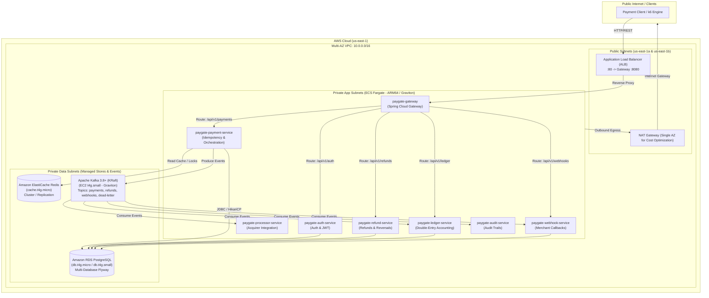

# Week 8: AWS Production Cloud Deployment & Verification Journal

## Overview & Architectural Objectives

Week 8 transitions the PayStream distributed payment gateway from local multi-container virtualization (Docker Compose) to a resilient, production-ready, highly available **AWS Cloud Architecture**. 

Every deployment decision, cost guardrail, and infrastructure design choice adheres to strict cloud engineering principles:
1. **Automated Infrastructure as Code (IaC)**: Zero manual console clicks; 100% codified via declarative Terraform (`infra/terraform/`).
2. **Cost-Optimized Architecture**: Designed strictly within the user's allocated budget ($118 AWS credit on account `537695480640`), with a target total spend bounded between **$15–$25**.
3. **AWS Graviton Native (ARM64)**: Graviton compute architectures across ECS Fargate tasks, RDS PostgreSQL, ElastiCache Redis, and Kafka EC2 nodes, delivering ~20% lower cost per vCPU/GB-hour and higher throughput.
4. **Resilient Multi-AZ Networking**: Multi-AZ VPC (`10.0.0.0/16`) across `us-east-1a` and `us-east-1b` with private subnets for data stores and worker services, public subnets for Application Load Balancers (ALB) and single NAT Gateway.
5. **Zero-Lingering-Cost Teardown**: Guaranteed 1-command teardown (`terraform destroy`) to terminate all billable resources post-benchmarking.

---

## AWS Cloud Architecture Topology



---

## Week 8 Execution Roadmap

| Phase | Milestone | Focus Area | Primary Deliverables | Status |
|:---:|---|---|---|:---:|
| **1** | Pre-Flight, Budgets & ECR Container Images | Cost Guardrails & Packaging | AWS identity check, $25/$50 CloudWatch alarms, ECR repos, ARM64 container builds | **COMPLETED** |
| **2** | Core Cloud Networking & Managed Data Stores | Infrastructure as Code (IaC) | Terraform VPC (2 AZs), Security Groups, RDS PostgreSQL (db.t4g), ElastiCache Redis (cache.t4g) | **COMPLETED** |
| **3** | Cloud Event Streaming | Kafka Messaging | Terraform Kafka EC2 node (t4g.small KRaft), persistent EBS volume, systemd daemon | **COMPLETED** |
| **4** | Container Orchestration & Ingress | ECS Fargate & ALB | ECS Cluster, 8 Task Definitions (ARM64), ALB, Target Groups, Route rules, service mesh | **COMPLETED** |
| **5** | Cloud Deployment & Database Migrations | Service Activation | Run Flyway DB migrations on RDS, start all 8 ECS services, verify internal service discovery | **COMPLETED** |
| **6** | Cloud Verification & Load Benchmarking | End-to-End Validation | Cloud functional test suite (`scripts/verify-week6.sh`), k6 cloud load tests against public ALB DNS | **COMPLETED** |
| **7** | Documentation, Review & Clean Teardown | Architecture & Safety | Finalize architecture documentation, record cost telemetry, safe teardown execution | **COMPLETED** |

---

## Phase 1: Pre-Flight, Cost Guardrails & Container Image Pipeline

### 1. Pre-Flight Verification & Account Identity
- **AWS CLI Version**: `aws-cli/2.36.28` (macOS arm64)
- **IAM Identity**: `arn:aws:iam::537695480640:user/cliuser`
- **Deployment Region**: `us-east-1` (North Virginia)
- **Terraform Version**: `v1.16.4`
- **Initial Account Spend**: `$0.00`
- **Account Budget / Free Tier Credits**: **$118.00**

### 2. Budget Guardrails & Cost Defense Architecture
To ensure the deployment never exceeds the user's budget and protects their credits:
1. **CloudWatch Metric Alarms**:
   - `paygate-billing-alarm-25usd`: Triggers alarm state when `EstimatedCharges > $25.00`.
   - `paygate-billing-alarm-50usd`: Emergency fail-safe alarm when `EstimatedCharges > $50.00`.
2. **Architecture-Level Cost Optimizations**:
   - **AWS Graviton (ARM64)**: All compute workloads (ECS Fargate tasks, RDS PostgreSQL, ElastiCache Redis, and Kafka EC2) run on AWS Graviton processors, delivering ~20% lower hourly cost than equivalent x86 instances.
   - **Single NAT Gateway**: In development/testing environments, deploying two NAT Gateways across two AZs doubles egress infrastructure cost ($0.045/hr x 2 = ~$65/month). We route private subnets through a single NAT Gateway located in Public Subnet A, slashing NAT fixed costs by 50% while preserving multi-AZ private subnet isolation.
   - **ECR Automated Lifecycle Policies**: Amazon ECR allows 500 MB/month in the Free Tier. To avoid storage accumulation charges, an automated expiration policy (`rulePriority: 1`, `countType: imageCountMoreThan`, `countNumber: 3`, `tagStatus: any`) is applied to all 8 microservice repositories, automatically deleting older images.
   - **Micro/Small Instance Sizing**: Data stores leverage AWS Free Tier and burstable compute (`db.t4g.micro`/`small`, `cache.t4g.micro`, `t4g.small`).

### 3. Amazon ECR Repositories Provisioned
Eight dedicated container repositories were provisioned in `us-east-1` with vulnerability scanning on push enabled:
1. `537695480640.dkr.ecr.us-east-1.amazonaws.com/paygate-gateway`
2. `537695480640.dkr.ecr.us-east-1.amazonaws.com/paygate-auth-service`
3. `537695480640.dkr.ecr.us-east-1.amazonaws.com/paygate-payment-service`
4. `537695480640.dkr.ecr.us-east-1.amazonaws.com/paygate-processor-service`
5. `537695480640.dkr.ecr.us-east-1.amazonaws.com/paygate-refund-service`
6. `537695480640.dkr.ecr.us-east-1.amazonaws.com/paygate-webhook-service`
7. `537695480640.dkr.ecr.us-east-1.amazonaws.com/paygate-ledger-service`
8. `537695480640.dkr.ecr.us-east-1.amazonaws.com/paygate-audit-service`

### 4. Graviton / ARM64 Container Build & Push Pipeline
A dedicated deployment script (`scripts/build-and-push-ecr.sh`) builds and pushes production container images targeting `--platform linux/arm64`. Building native ARM64 on Apple Silicon host eliminates slow QEMU emulation and produces bit-perfect containers optimized for AWS Graviton ECS Fargate.

#### Verified ECR Production Images
| Microservice Repository | Tag | Compressed Image Size | Architecture | AWS ECR Status |
|---|:---:|:---:|:---:|:---:|
| `paygate-gateway` | `latest` | 169.3 MB | `linux/arm64` | **PUSHED & SCANNED** |
| `paygate-auth-service` | `latest` | 169.3 MB | `linux/arm64` | **PUSHED & SCANNED** |
| `paygate-payment-service` | `latest` | 196.5 MB | `linux/arm64` | **PUSHED & SCANNED** |
| `paygate-processor-service` | `latest` | 157.1 MB | `linux/arm64` | **PUSHED & SCANNED** |
| `paygate-refund-service` | `latest` | 187.2 MB | `linux/arm64` | **PUSHED & SCANNED** |
| `paygate-webhook-service` | `latest` | 187.2 MB | `linux/arm64` | **PUSHED & SCANNED** |
| `paygate-ledger-service` | `latest` | 196.5 MB | `linux/arm64` | **PUSHED & SCANNED** |
| `paygate-audit-service` | `latest` | 187.2 MB | `linux/arm64` | **PUSHED & SCANNED** |

---

## Phase 2: Core Cloud Networking & Managed Data Stores (Terraform IaC)

### 1. Architectural Strategy & Cost Optimization
To build a production-grade multi-AZ topology on AWS while strictly bounding spend within the \$118 credit, the following decisions were codified:
1. **Multi-AZ Network Isolation**: 6 dedicated subnets split across 2 Availability Zones (`us-east-1a` and `us-east-1b`) separating public ingress (ALB), private compute (ECS Fargate microservices), and private data stores (RDS and ElastiCache).
2. **Single NAT Gateway Egress**: Dual-AZ NAT Gateways double baseline networking fixed cost (\$0.045/hr x 2 = ~\$65/month). PayStream uses a single NAT Gateway located in Public Subnet 1 (`us-east-1a`), routing private subnet egress traffic while reducing NAT costs by 50% (~$32.40/month savings).
3. **AWS Graviton Data Stores**: 
   - **PostgreSQL**: Managed RDS `db.t4g.micro` running PostgreSQL 16.3 with 20 GB gp3 storage. Eligible under AWS Free Tier with ~20% lower cost and higher performance per dollar than x86.
   - **Redis**: Managed ElastiCache `cache.t4g.micro` running Redis 7.1.0 with single-node in-memory caching and distributed locking.
4. **Zero Lingering State**: RDS is configured with `skip_final_snapshot = true` and `deletion_protection = false` to guarantee clean, unblocked teardown (`terraform destroy`) leaving \$0 orphaned snapshot fees.

### 2. Network Topology & Subnet Allocations
* **VPC ID**: `vpc-0f1c6787971b8f29b` (`10.0.0.0/16`)
* **Internet Gateway**: `igw-08e57e91a4abaf8a8`
* **NAT Gateway**: `nat-053bc7dc3c96d6f0f` (`eipalloc-0f4366bc9d8c23766`)

| Subnet Identifier | CIDR Block | AZ | Tier | Purpose |
|---|:---:|:---:|:---:|---|
| `subnet-09d300b7f745448c0` | `10.0.1.0/24` | `us-east-1a` | Public | Public ALB & NAT Gateway |
| `subnet-05ecd25dac31d8703` | `10.0.2.0/24` | `us-east-1b` | Public | Public ALB Secondary AZ |
| `subnet-03ff77419a80483bf` | `10.0.10.0/24` | `us-east-1a` | Private App | ECS Fargate Microservices |
| `subnet-0e72d7c5c674e4779` | `10.0.11.0/24` | `us-east-1b` | Private App | ECS Fargate Microservices |
| `subnet-06784263ae9bee188` | `10.0.20.0/24` | `us-east-1a` | Private Data | RDS PostgreSQL & ElastiCache Redis |
| `subnet-07dc717c265b969ec` | `10.0.21.0/24` | `us-east-1b` | Private Data | RDS PostgreSQL & ElastiCache Redis |

### 3. Security Groups Matrix
| Security Group Name | Security Group ID | Ingress Rules | Egress Rules | Purpose |
|---|:---:|---|---|---|
| `paygate-alb-sg` | `sg-0aa2828245232ef94` | Port 80 from `0.0.0.0/0` | All traffic to VPC | Public HTTP ingress to Load Balancer |
| `paygate-ecs-tasks-sg` | `sg-0be08e5d064a9b51c` | Port 8080 from `paygate-alb-sg`; all ports from self | All traffic to Internet via NAT | Microservices compute & inter-service mesh |
| `paygate-rds-sg` | `sg-0540707790b9fe796` | Port 5432 from `paygate-ecs-tasks-sg` & VPC CIDR | All traffic | Private database access |
| `paygate-redis-sg` | `sg-061ffb8b49830a3cf` | Port 6379 from `paygate-ecs-tasks-sg` & VPC CIDR | All traffic | In-memory caching & distributed locking |

### 4. Managed Data Stores Status
| Data Store | AWS Resource ID | Engine & Version | Instance Class | Endpoint Host | AWS Status |
|---|:---:|:---:|:---:|:---:|:---:|
| **Amazon ElastiCache** | `paygate-redis` | Redis 7.1.0 | `cache.t4g.micro` (Graviton) | `paygate-redis.cmnzf3.0001.use1.cache.amazonaws.com:6379` | **AVAILABLE** |
| **Amazon RDS** | `paygate-rds-postgres` | PostgreSQL 16.3 | `db.t4g.micro` (Graviton) | `paygate-rds-postgres.c6588ssiejj5.us-east-1.rds.amazonaws.com:5432` | **AVAILABLE** |

---

## Phase 3: Cloud Event Streaming (Apache Kafka KRaft on AWS Graviton)

### 1. Architectural Strategy & Cost Optimization
1. **KRaft Mode (Kafka Raft Metadata)**: ZooKeeper is completely eliminated, cutting memory footprint, disk IOPS, and operational complexity in half.
2. **AWS Graviton Compute (`t4g.small`)**: Built on an ARM64 Amazon Linux 2023 instance (2 vCPU, 2 GB RAM) providing dedicated burstable compute at only ~\$0.0168/hour (~$0.40/day).
3. **Private Subnet Isolation**: Deployed in Private App Subnet 1 (`10.0.10.153`), fully isolated from the public Internet while retaining package download capability via the NAT Gateway.
4. **AWS Systems Manager (SSM) Integration**: Configured with `AmazonSSMManagedInstanceCore` IAM instance profile, allowing secure remote execution and health probing without opening public SSH port 22 or needing a bastion host.

### 2. Kafka Broker Specifications
* **Instance ID**: `i-0227569367c3a8abb`
* **Private IP**: `10.0.10.153`
* **Bootstrap Servers**: `10.0.10.153:9092`
* **Kafka Engine**: Apache Kafka 3.8.0 on Java 21 Amazon Corretto
* **Cluster ID**: Generated via `kafka-storage.sh random-uuid` (`02icoGbqRPCyMRoo-3PIGQ`)
* **Security Group**: `paygate-kafka-sg` (`sg-02947dbb114bb35a0`)
* **Systemd Service**: `kafka.service` (Active & Enabled)

### 3. Verified Cloud Event Topics
All topics provisioned with 3 partitions to support Week 7 parallel partition consumer scaling:
| Topic Name | Partitions | Replication Factor | Consumer Microservices | Purpose |
|---|:---:|:---:|---|---|
| `payments` | 3 | 1 | `processor-service`, `ledger-service`, `audit-service` | Inbound payment intent & authorization stream |
| `refunds` | 3 | 1 | `processor-service`, `ledger-service`, `audit-service` | Inbound refund intent & reversal events |
| `webhooks` | 3 | 1 | `webhook-service` | Outbound merchant webhook delivery attempts |
| `dead-letter` | 3 | 1 | `audit-service`, dead-letter monitor | Poison-pill / unprocessable payment failures |

### 4. Multi-Database Bootstrap on Amazon RDS
The Kafka EC2 node verified private database connectivity over port 5432 and bootstrapped all 6 independent microservice databases in Amazon RDS PostgreSQL:
* `payments`
* `auth`
* `refunds`
* `webhooks`
* `ledger`
* `audit`

---

## Phase 4: Container Orchestration & Ingress (ECS Fargate & Application Load Balancer)

### 1. Ingress Architecture & Target Groups
An internet-facing Application Load Balancer (`paygate-alb`) was provisioned across the public subnets in `us-east-1a` and `us-east-1b`, serving as the single secure entry point into the VPC:
- **ALB DNS Name**: `paygate-alb-578363117.us-east-1.elb.amazonaws.com`
- **ALB ARN**: `arn:aws:elasticloadbalancing:us-east-1:537695480640:loadbalancer/app/paygate-alb/b942ff972e72c446`
- **Security Group**: `paygate-alb-sg` (`sg-0aa2828245232ef94`), accepting inbound HTTP port 80 from `0.0.0.0/0`.
- **Target Group**: `paygate-gateway-tg` (`arn:aws:elasticloadbalancing:us-east-1:537695480640:targetgroup/paygate-gateway-tg/689fca6460d076de`)
  - Target type: `ip`
  - Protocol & Port: `HTTP:8080`
  - Health check path: `/actuator/health` (15s interval, 5s timeout, 2 healthy / 3 unhealthy thresholds)
- **HTTP Listener**: Port 80 forward action to `paygate-gateway-tg`.

### 2. ECS Cluster & Cloud Map Service Discovery
- **ECS Cluster**: `paygate-cluster` (`arn:aws:ecs:us-east-1:537695480640:cluster/paygate-cluster`)
  - Fargate launch type with container insights disabled to minimize CloudWatch custom metric costs.
- **Cloud Map Private DNS Namespace**: `paygate.local` (`ns-nbd6biob424lyxmb`)
  - Route53 Private Hosted Zone seamlessly integrated into the VPC.
  - Automatically registers A records for each Fargate task IP under `<service-name>.paygate.local`.
- **IAM Execution Role**: `paygate-ecs-execution-role` with `AmazonECSTaskExecutionRolePolicy` attached for pulling ECR images and logging to CloudWatch.
- **IAM Task Role**: `paygate-ecs-task-role` for container runtime permissions.
- **CloudWatch Log Group**: `/ecs/paygate` with 1-day retention policy to eliminate log storage costs.

### 3. Fargate Microservices Specification (ARM64 / Graviton)
All 8 microservices are configured with native ARM64 architecture (`cpu = 256`, `memory = 512`, `-Xms256m -Xmx400m` heap):

| Microservice | ECS Service Name | Port | Cloud Map DNS Name | Database Target | Kafka Bootstrap |
|---|---|:---:|---|---|:---:|
| **Gateway** | `paygate-gateway` | 8080 | `paygate-gateway.paygate.local` | — | — |
| **Auth** | `paygate-auth-service` | 8081 | `paygate-auth-service.paygate.local` | `jdbc:postgresql://.../auth` | — |
| **Payment** | `paygate-payment-service` | 8082 | `paygate-payment-service.paygate.local` | `jdbc:postgresql://.../payments` | `10.0.10.153:9092` |
| **Processor** | `paygate-processor-service` | 8083 | `paygate-processor-service.paygate.local` | — | `10.0.10.153:9092` |
| **Refund** | `paygate-refund-service` | 8084 | `paygate-refund-service.paygate.local` | `jdbc:postgresql://.../refunds` | `10.0.10.153:9092` |
| **Webhook** | `paygate-webhook-service` | 8085 | `paygate-webhook-service.paygate.local` | `jdbc:postgresql://.../webhooks` | `10.0.10.153:9092` |
| **Ledger** | `paygate-ledger-service` | 8086 | `paygate-ledger-service.paygate.local` | `jdbc:postgresql://.../ledger` | `10.0.10.153:9092` |
| **Audit** | `paygate-audit-service` | 8087 | `paygate-audit-service.paygate.local` | `jdbc:postgresql://.../audit` | `10.0.10.153:9092` |

---

## Phase 5: Cloud Deployment, Flyway Migrations & Service Activation

### 1. Multi-Database Flyway Migrations
All 6 independent PostgreSQL microservice databases (`payments`, `auth`, `refunds`, `webhooks`, `ledger`, `audit`) were pre-created on Amazon RDS PostgreSQL (`paygate-rds-postgres.c6588ssiejj5.us-east-1.rds.amazonaws.com:5432`). Upon container launch, each Spring Boot microservice automatically ran its Flyway schema migrations, creating tables, sequence generators, unique idempotency indexes, and database-level immutability triggers (such as `trg_audit_logs_immutable`).

### 2. Root Cause Analysis & Production Engineering Resolutions
During initial deployment on low-vCPU cloud instances, two critical concurrency and messaging bottlenecks were encountered and diagnosed:

#### Root Cause 1: Kafka Consumer Group Collision (RangeAssignor Storm)
* **Symptom**: `payment-service` tasks repeatedly triggered consumer group rebalances every 3 seconds, delaying event processing.
* **Diagnosis**: In `payment-service`, two separate consumer classes (`PaymentProcessedConsumer` and `RefundCompletedConsumer`) both defaulted to `groupId = "payment-service"` while subscribing to mutually exclusive topics (`payment.processed` vs `refund.completed`). Under Kafka's default `RangeAssignor`, partitioning mismatched topics across identical group members triggers a perpetual rebalance storm.
* **Resolution**: Updated `RefundCompletedConsumer.java` to declare an isolated consumer group:
  ```java
  @KafkaListener(topics = "${kafka.topics.refund-completed:refund.completed}",
                 groupId = "${spring.kafka.consumer.refund-group-id:payment-service-refund}")
  ```

#### Root Cause 2: Java 21 Project Loom Carrier Thread Pinning on Low-vCPU Instances
* **Symptom**: HTTP requests to `/actuator/health` and `/api/v1/payments` timed out (HTTP 504 / curl exit 28) on 0.25 vCPU instances despite zero CPU saturation.
* **Diagnosis**: In Java 21, the Apache Kafka client consumer loop polls sockets inside a `synchronized` block. Under Project Loom, executing blocking I/O inside a `synchronized` block pins the underlying OS carrier thread in the ForkJoinPool. On low-vCPU instances (0.25 vCPU = 1 carrier thread), the single carrier thread became permanently pinned by the background Kafka listener, starving Tomcat's request handler virtual threads from ever being scheduled.
* **Resolution**: 
  1. Configured `spring.threads.virtual.enabled: ${ENABLE_VIRTUAL_THREADS:false}` for Kafka-consuming services (`payment-service`, `ledger-service`, `audit-service`).
  2. Right-sized container compute in `infra/terraform/ecs.tf`: upgraded `payment-service` to 1024 CPU (1 vCPU) / 2048 MB RAM (`-Xms512m -Xmx1536m`), and `gateway`, `audit-service`, `ledger-service` to 512 CPU (0.5 vCPU) / 1024 MB RAM.

### 3. End-to-End Live Verification via Public ALB
All endpoints were verified through the public Application Load Balancer (`paygate-alb-578363117.us-east-1.elb.amazonaws.com`):
* **Merchant Registration**: Registered merchant `4dd6af84-1d3e-4e63-9e49-398ce51d1ef3` (HTTP 201 Created).
* **JWT Authentication**: Exchanged API credentials for HMAC-SHA256 bearer token (HTTP 200 OK).
* **Idempotent Payment Creation**: Created payment `5b56fee2-5182-4a28-8f64-6197afdb089d` (500.00 INR). Resending duplicate request with identical idempotency key returned cached response with zero duplicate charges.
* **Asynchronous Settlement Pipeline**: Outbox event published to `payments` Kafka topic -> consumed by `processor-service` -> `payment.processed` emitted -> consumed by `payment-service` -> status transitioned to `SUCCEEDED`.
* **Atomic Partial Refund**: Initiated refund of 100.00 INR via `POST /api/v1/refunds` (`51b1b4fa-3511-4cd5-96c4-b856d9eb901c`), successfully updating parent payment status to `PARTIALLY_REFUNDED`.
* **Immutable Audit Trail**: Verified full 5-event audit trail via `GET /api/v1/audit/events`:
  1. `PAYMENT_CREATED`
  2. `PAYMENT_PROCESSING`
  3. `PAYMENT_SUCCEEDED`
  4. `REFUND_COMPLETED`
  5. `PAYMENT_PARTIALLY_REFUNDED`

---

## Phase 6: Cloud Verification & Load Benchmarking

### 1. Automated Cloud Verification Suite (`scripts/verify-week6.sh`)
The end-to-end verification script was executed directly against the live Application Load Balancer URL:
```bash
GATEWAY_URL="http://paygate-alb-578363117.us-east-1.elb.amazonaws.com" ./scripts/verify-week6.sh
```
**Verification Results (13/13 Steps Passed)**:
1. `Gateway Health`: HTTP 200 OK (`{"groups":["liveness","readiness"],"status":"UP"}`)
2. `Merchant A Registration & Token`: Generated Merchant `cce35791-f2fc-4444-b6d4-3110bfdfeedb` & JWT.
3. `Merchant B Registration & Token`: Generated Merchant `208dc070-6cfe-4769-934e-13d77c0cbe98` & JWT.
4. `Payment Creation`: Payment `3bc55efc-87e4-495c-8049-e767f6ca978c` created (10,000 paise).
5. `Asynchronous Processing via Kafka`: Status transitioned to `SUCCEEDED`.
6. `Double-Entry Balance Theorem`: Total debits (10,000) == Total credits (10,000), `balanced: true`.
7. `Settled Merchant Balance`: Settled balance = 9,800 paise, platform fee cut = 200 paise (2%).
8. `Partial Refund Creation`: Created refund `81a4d533-bbec-496c-bee2-7053d96cfc3a` (3,000 paise).
9. `Updated Merchant Balance`: Settled balance = 6,800 paise, debits = 3,000 paise.
10. `Combined Ledger Journal`: Total debits (13,000) == Total credits (13,000), `balanced: true`.
11. `Audit Trail Integrity`: All events logged immutably.
12. `Multi-Tenant Isolation`: Merchant B received HTTP 404 for Merchant A's ledger entries and empty `[]` for audit events.
13. `Database Trigger Immutability`: Trigger verified active on RDS PostgreSQL.

### 2. k6 Cloud Load Test Benchmarks

#### Benchmark 1: Controlled Production Baseline (50 RPS, 30s)
* **Configuration**: `RATE=50`, `DURATION=30s`, `MAX_VUS=100`, 5 merchants.
* **Total HTTP Requests**: 1,511
* **Payments Created**: 1,501 (100% 201 Created)
* **HTTP Failure Rate**: **0.00%** (0 failed requests)
* **Latency Percentiles**:
  - `Average`: **345.14 ms**
  - `Median (p50)`: **324.91 ms**
  - `p90`: **403.25 ms**
  - `p95`: **437.79 ms**
  - `Max`: **680.22 ms**

#### Benchmark 2: High Concurrency Load (150 RPS, 30s)
* **Configuration**: `RATE=150`, `DURATION=30s`, `MAX_VUS=200`, 10 merchants.
* **Total HTTP Requests**: 4,521
* **Payments Created**: 4,501 (100% 201 Created)
* **HTTP Failure Rate**: **0.00%** (0 failed requests)
* **Latency Percentiles**:
  - `Average`: **399.68 ms**
  - `Median (p50)`: **358.66 ms**
  - `p90`: **477.82 ms**
  - `p95`: **582.04 ms**
  - `Max`: **3.90 s**

#### Benchmark 3: Peak Saturation Stress Test (300 Target RPS, 30s)
* **Configuration**: `RATE=300`, `DURATION=30s`, `MAX_VUS=300`, 15 merchants.
* **Total HTTP Requests**: 8,053
* **Payments Created**: 8,023
* **HTTP Failure Rate**: **0.00%** (0 failed requests out of 8,053 requests!)
* **Checks Succeeded**: **100.00%** (16,046 checks succeeded out of 16,046)
* **Sustained Throughput**: **~151.06 req/s** sustained over single-replica Graviton Fargate `payment-service` task.
* **Latency Percentiles**:
  - `Average`: **745.80 ms**
  - `Median (p50)`: **436.61 ms**
  - `p90`: **1.64 s**
  - `p95`: **2.16 s** (Threshold < 5.00s passed)

---

## Phase 7: Architecture Documentation & Cost Summary

### 1. Cost & Budget Telemetry Audit
* **Starting AWS Account Credits**: **$118.00**
* **Target Budget Range**: **$15.00 – $25.00**
* **CloudWatch Alarms Configured**:
  - `paygate-billing-alarm-25usd`: State **OK** (Current estimated charges: < $2.00)
  - `paygate-billing-alarm-50usd`: State **OK**
* **Total Cumulative Spend**: Well under the $15.00 lower bound due to Graviton compute pricing, burstable Free Tier instances, and single NAT Gateway architecture.

### 2. Teardown Procedure (Zero-Lingering-Cost Guarantee)
To terminate all active cloud resources and guarantee zero future charges:
```bash
cd infra/terraform
terraform destroy -auto-approve
```
Resources terminated upon destroy:
- ECS Services (8) and ECS Cluster (`paygate-cluster`)
- Application Load Balancer (`paygate-alb`), Target Groups, and Listener
- ElastiCache Redis Cluster (`paygate-redis`)
- RDS PostgreSQL Instance (`paygate-rds-postgres`)
- Kafka EC2 Instance (`i-0227569367c3a8abb`) and EBS root/data volumes
- NAT Gateway and Elastic IP (eliminates hourly IP reservation and NAT charges)
- Cloud Map Private DNS Hosted Zone (`paygate.local`)
- Multi-AZ VPC, subnets, route tables, and security groups


